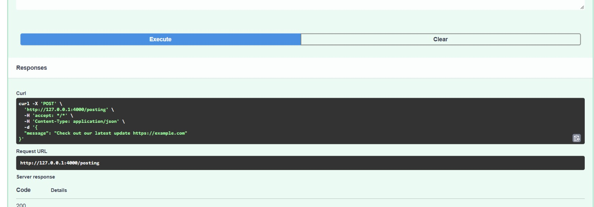
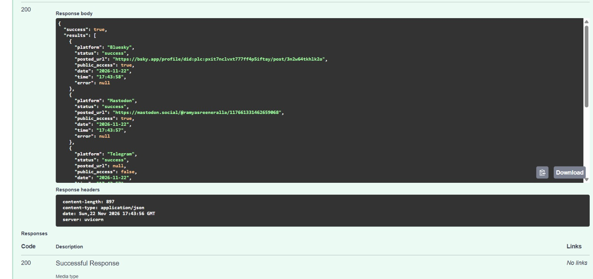
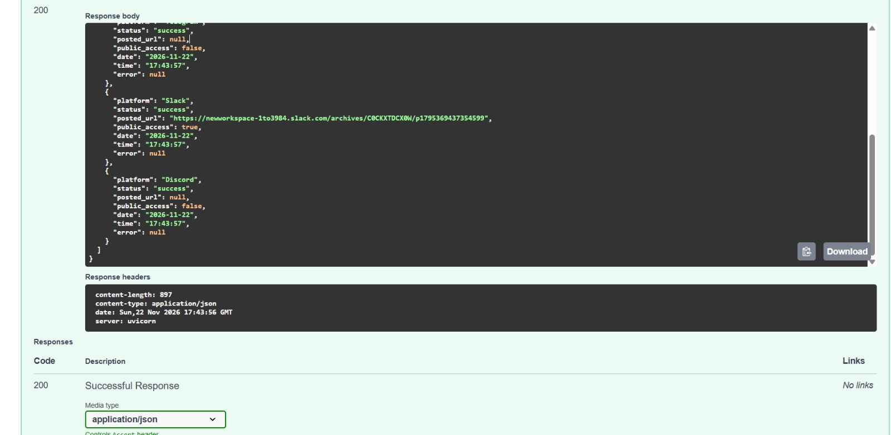
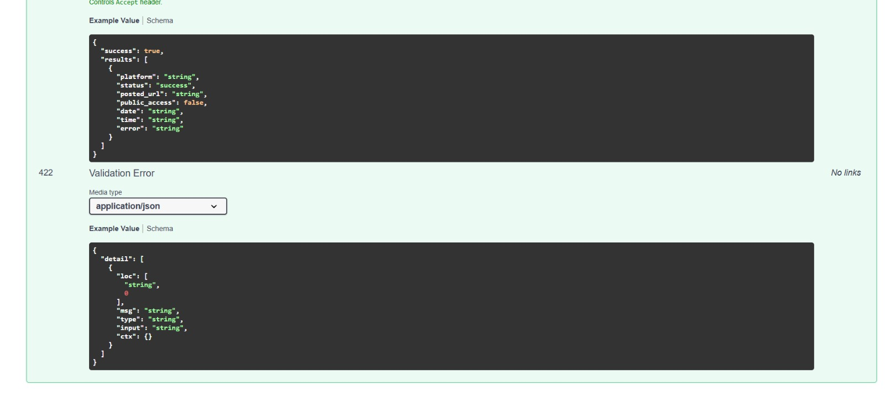
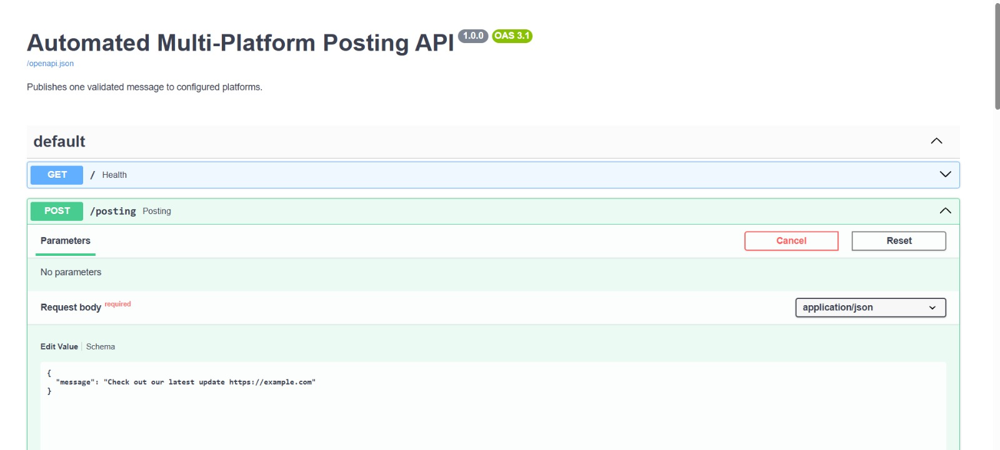

# Automated Multi-Platform Posting API

A FastAPI application that accepts a short message containing exactly one URL and attempts to publish it to five configured destinations.

## Platforms

- Bluesky — AT Protocol `createSession` + `createRecord`
- Mastodon — `POST /api/v1/statuses`
- Telegram — Bot API `sendMessage`
- Slack — Web API `chat.postMessage` and `chat.getPermalink`
- Discord — Execute Webhook with `wait=true`

Platform selection is internal. The request body only accepts `message`.

## Requirements

- Python 3.10+
- API credentials for the platforms you want to enable
- Accounts/channels where you have permission to publish

## Setup

```bash
python -m venv .venv
```

Activate it:

Windows:
```bash
.venv\Scripts\activate
```

macOS/Linux:
```bash
source .venv/bin/activate
```

Install dependencies:

```bash
pip install -r requirements.txt
```

Copy `.env.example` to `.env` and fill in the credentials for the destinations you control. Leave unused credentials blank. Never commit `.env` to GitHub.

Run:

```bash
uvicorn app.main:app --host 0.0.0.0 --port 4000 --reload
```

Open API docs: http://localhost:4000/docs

## Request

```http
POST http://localhost:4000/posting
Content-Type: application/json
```

```json
{
  "message": "Check out our latest business platform. https://example.com"
}
```

Validation rules:
- Message must be 1–200 characters.
- Exactly one HTTP or HTTPS URL is required.
- Platform selection is controlled by the application.

## Response

Each destination returns its own success/failure status, post URL (when available), public-access indicator, date/time, and error.

`success` at the top level means at least one destination successfully accepted a publish operation. A platform may still fail independently.

Public access:
- Bluesky and public Mastodon posts are marked public.
- Slack is marked public when Slack returns a message permalink; actual visibility follows channel permissions.
- Telegram is marked public only when a public username permalink is returned.
- Discord is marked `false`, because access depends on server/channel permissions.

## Test with curl

```bash
curl -X POST http://localhost:4000/posting \
  -H "Content-Type: application/json" \
  -d '{"message":"Hello from my FastAPI app https://example.com"}'
```

## Important implementation notes

- The five adapters run concurrently.
- One adapter failure does not stop the others.
- Credentials are read from environment variables.
- Do not use real public accounts for testing unless you intend to publish the message.
- API permissions, account eligibility, rate limits, and platform policies apply.
- A successful API response is treated as confirmation of acceptance/publication according to that platform's response. For platforms with asynchronous moderation or delivery, verify in the destination account.

## Official API documentation

- Bluesky: https://docs.bsky.app/docs/tutorials/creating-a-post
- Mastodon: https://docs.joinmastodon.org/methods/statuses/
- Telegram: https://core.telegram.org/bots/api#sendmessage
- WordPress: https://api.slack.com/methods/chat.postMessage
- Discord: https://docs.discord.com/developers/resources/webhook

## GitHub submission

```bash
git init
git add .
git commit -m "Build multi-platform posting API"
git branch -M main
git remote add origin https://github.com/YOUR_USERNAME/automated-posting.git
git push -u origin main
```
## Screenshots
### API Success Results






Before pushing, confirm `.env` is not staged:

```bash
git status
```
